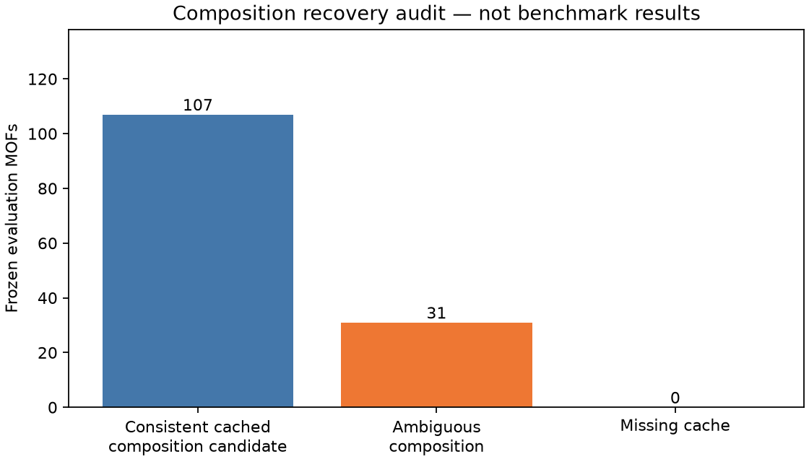

# Local constant/ridge preparation — 26 October 2026

**Outcome: useful preparation complete; real-data fitting blocked.** No compatible
training labels were found locally. No constant/ridge model was fitted to the
138-MOF pool, no benchmark predictions or scores were manufactured, and no
evaluation targets were used for tuning. Phase 3 remains incomplete.

The Windows checkout started clean on `main`, tracking `origin/main`. Targeted
Graphify retrieval located `evaluate_composition_baselines`; its source and
related data/manifest files were inspected directly. The graph remains an older
snapshot; this report is indexed in its current navigation supplement.

## Verified target and reference definitions

- Frozen file: `artifacts/kaggle/odac25_paired_targets_2026-09-14/paired_targets.json`.
  SHA256 `58c5dd5bec75366e3cd95dbd7ba9d714d1ff0163a560158cf154640aed5095bf`.
  All six evidence-manifest hashes pass; the eight reference-lookup ZIP payloads
  match the extracted local evidence byte-for-byte.
- 560,208 original validation rows reduced to 285 selected single-gas labels and
  **138 unique paired `mof_id` records**, official split `val`. IDs originate from
  `mof_name`; exact selected trajectory, `fid`, source index and gas are preserved.
  Paired labels/provenance reconstruct exactly from the selected single-gas rows.
- Target order: `[CO2, H2O]`, **eV per single-molecule adsorption configuration**,
  not eV/atom. Exact one molecule only; largest stored `fid` per trajectory, then
  minimum final-frame `energy_ads_corrected` per MOF/gas. No re-selection here.
- Intended physical definition: `Eads = Ecomplex − Ebare − Egas`. The observed
  archive identity instead must explicitly use the original/pre-k-point total:
  `energy_ads_corrected = energy_old − energy_mof − Egas`.
  The archived 2,048-row audit gives constants −22.990396 eV (CO2) and
  −14.236396 eV (H2O), with identity spreads below 3.3e−14 eV. Using `energy`
  instead has spreads 1.07278/1.48885 eV. These are archived field identities,
  not fitted model parameters or proof of a compatible reference geometry.
- The reference lookup still has **67 distinct unresolved reference energies,
  62 with no stored original/corrected energy match**. This work does not resolve
  that issue. Supervised regression against compatible copies of the *same field*
  could proceed independently; reconstructing UMA adsorption energies cannot
  silently bypass the reference-geometry gate.
- The old ColabFit path uses `adsorption_energy`/`energy_ads` and last stored rows
  without `fid`. The historical 92-pair notebook result is not locally available
  as a compatible corrected/final-frame training export. It is not admitted.

## Local inventory and feature recovery

Searched project `data/`, `artifacts/`, `local/` and Windows `Downloads/` for raw
Parquet/LMDB/ASE-LMDB/pickle sources, excluding test fixtures and environments.
**No candidate raw files found in those roots.** Named ODAC25 downloads are small
copies of already archived audit/target/smoke ZIPs. This is a scoped local search,
not a claim about inaccessible Kaggle sessions or every directory on the PC.

Expected feature schema is unchanged: **118 dimensionless bare-parent elemental
fractions**, atomic numbers 1–118. Neither target energies nor relaxed guest
coordinates enter these features. Element fractions lose connectivity, topology,
cell size and conformation information; equal features do not prove equal MOFs.

|Available evidence|Count|Interpretation|
|---|---:|---|
|Evaluation IDs present in authenticated bare cache|138/138|ID coverage only|
|Consistent fractions across all cached candidates|107|Composition candidates; not full structure verification|
|Multiple non-equivalent fraction vectors for one ID|31|Ambiguous; feature row left blank, every candidate retained|
|Full parent coordinate exports matched locally|1|`jz4002345_si_002`, 114 atoms|
|Compatible training exports|0|Fitting blocked|

The 473,671-byte cache is bound to raw bare-shard SHA256
`9b1025cf1b5b4dd65e6c6a237458a6b736f261876498fc19b7a0c9cd5c585f83`.
Every cached count signature was checked against its atomic numbers. Fractions
are compared as exact rational numbers, so equivalent supercell scaling alone
does not create an ambiguity. No energy-based, first-record or smallest-cell
choice resolves the 31 ambiguous IDs. Full lists, candidate fractions and indices
are retained in the audit artifacts; the frozen pool was not reduced to 107.

For the one full parent export, atomic numbers, source index and source digest
match its archived cache entry; the CIF has the same 114-atom composition. Its
CIF cell representation differs from the JSON matrix (maximum component
0.00036898 Å); no coordinate replacement or rounding was performed. Chemistry,
proton placement and exact adsorption-reference identity remain separate reviews.



## Implementation and validation

- `mof_dac/surrogate_baseline.py`: immutable evaluation hash/pool gate; paired
  provenance validation; cache ambiguity preservation; bounded JSON/streamed
  JSONL parent manifests; parent geometry hashes, atom identities and finite
  coordinates/cells; reviewed source/group/alias requirements; separation guards.
- `mof_dac/material_baselines.py`: existing constant/ridge implementation reused.
  Added parent-group CV, invalid/fractional atom rejection, positive finite ridge
  penalty validation and rejection of fewer than two independent training groups.
- `scripts/local_surrogate_baseline.py`: local inventory/audit, feature CSV/JSON,
  coverage plot and guarded future fit command. No network, QE or inference path.
  Successful future fits save both gas predictions, train-fitted model parameters,
  CV selection, provenance and registered metrics. Failed admission produces no
  success result. It does not silently score a partial evaluation pool.
- **9 new tests passed**, including a synthetic end-to-end export/fit fixture,
  evaluation-label perturbation invariance, group-fold integrity, reference-field
  rejection, geometry/alias leakage, frozen-file mutation and ambiguous features.
  **4 relevant existing tests passed**; 30 unrelated tests were deselected.
  Synthetic test outputs are software checks, not material results.

The eight-ID cache sample took **0.00838 s**, with **39,300 bytes** peak traced
Python allocations. Scaling to all 138 took **0.08859 s**, with **873,554 bytes**
peak traced allocations. These measurements exclude JSON load, plotting and
native-library/process memory; they are not total RSS. Observed PC capacity:
15.33 GiB physical RAM, approximately 3.12–3.23 GiB available, 101–102 GiB free disk.
No large raw data were loaded or downloaded; BLAS/OpenMP were limited to one thread.

## Frozen modelling choices and admission requirements

Constant = training mean for each gas. Ridge = two-output linear regression on
118 fractions; each CV fold independently fits centering/scaling. Alpha grid
`[0.01, 0.1, 1, 10]`; deterministic sorted-parent-group round-robin folds, up to
five folds; minimize pooled two-gas validation MAE using **training groups only**;
ties choose smaller alpha. Refit once on all admitted training rows. No tuning
against the 138 labels and no preprocessing fit on their features.

Reject cross-pool MOF IDs/aliases, canonical parent-family groups or identical
stored geometries. Within training, shared aliases/exact geometries must belong
to the same CV group. Formula collisions are reported, not treated as proven
duplicates. Exact geometry hashing is not translation/symmetry/related-record
deduplication: a reviewed canonical parent/family map is still required. No
prefix-based family identity is guessed from names.

Registered metrics remain CO2 and H2O MAE/RMSE separately; competition
`delta = Eads(CO2) − Eads(H2O)` (lower first), delta MAE, Spearman and top-10
overlap. Ties use stable sorted MOF-ID order; constant predictions have undefined
Spearman (`null`), and their top-10 overlap is an arbitrary tie diagnostic.
Delta is not selectivity, working capacity or DAC performance. No metric was
computed on actual model predictions in this workstream.

## Exact missing data and next acquisition step

1. Obtain a **revision/source-hash-pinned official training export** retaining
   `mof_name`, official split, trajectory `name`, final-frame `fid`, source index,
   all adsorbate counts, `energy_ads_corrected` and documented energy convention.
   Export complete trajectories before v1 reduction; a few arbitrary trajectory
   frames cannot support a strongest-final-frame label. Reuse
   `select_relaxed_adsorbate_targets`/`pair_adsorbate_rows` for reduction.
2. Export corresponding bare parent JSON structures and source indices, plus
   all 138 evaluation parents. Resolve the 31 multi-composition identities by
   inspecting exact selected system/parent compositions and documented mappings;
   no silent guest subtraction or parent choice. Provide a reviewed canonical
   parent-family/alias map covering training and evaluation.
3. Small next step: export metadata and 8–16 complete, distinct training-parent
   examples on the machine that holds the official database. Transfer those
   compact exports first, measure extraction size/RAM, then budget the full
   compatible subset. Official card access from this unauthenticated Windows
   request returned **HTTP 401**; no credentials were requested or exposed.

The research-mirror alternative is **unapproved and compatibility-unverified**:
[pinned AtomMOF metadata](https://huggingface.co/api/datasets/nayoung10/AtomMOF-data/tree/81a85299823a7e75e0ed7fe39640c99297906080?recursive=true)
was fetched as small metadata only. Proposed files at that revision:

|File|Exact published size|Storage proposal, before any download|
|---|---:|---|
|`odac25/odac25_test.lmdb`|141,197,312 bytes (~134.66 MiB)|At least 0.5 GiB for bounded inspection/export|
|`odac25/odac25_train.lmdb`|6,547,623,936 bytes (~6.10 GiB)|At least 8 GiB if direct download; 14 GiB if a cache creates a second copy, plus measured export growth|

These are disk reservations, not RAM estimates. Test corresponds to original
validation; it cannot become training. Mirror record-level train/val splits do
not establish parent-level separation, and corrected-label/fid completeness is
unverified. The metadata alone is not a reason to download 6.55 GB. First inspect
a bounded sample after the acquisition choice is reviewed; do not deserialize
untrusted pickle payloads as arbitrary executable Python. No large download ran.

## Reproduce and resume

From the repository root (use a new output directory to retain previous evidence):

```powershell
$env:OPENBLAS_NUM_THREADS='1'
$env:OMP_NUM_THREADS='1'
python -m scripts.local_surrogate_baseline audit --output local/surrogate-audit-new
python -m pytest tests/test_surrogate_baseline.py -q -p no:cacheprovider --basetemp=local/surrogate-tests-new
```

Future fit command, **only after compatible exports exist**:

```powershell
python -m scripts.local_surrogate_baseline fit --train-labels data/external/reviewed/train-pairs.json --train-parents data/external/reviewed/train-parents.jsonl --evaluation-parents data/external/reviewed/evaluation-parents.jsonl --output local/surrogate-fit-new
```

Training JSON requires `contract` equal to `mof_dac.surrogate_baseline.CONTRACT`,
`complete_trajectories: true`, an actual `provenance_review` reference, and v1
`single_gas_targets`/`paired_targets` with gas provenance. These are review
assertions, not metadata to fabricate. Parent JSONL lines require `mof_id`,
`split`, `parent_group_id`, `aliases`, `identity_review`, `source_sha256`,
`source_index`, `geometry_path`, `geometry_sha256`. Geometry JSON preserves
`numbers`, `positions_angstrom`, `cell_angstrom`, and `metadata.mof_name`.
No blanket approval is implied by the presence of a nonempty review string.

Local evidence: `local/surrogate-baseline-20261026/audit-v1/` (audit, all 138
feature-status rows, candidate fractions/provenance, one full-export feature,
sample measurements, plot); source metadata in sibling `source-metadata/`.
The tracked compact audit is [surrogate_baseline_local_20261026.json](surrogate_baseline_local_20261026.json).

**Next decision:** obtain the compatible official export, or review a bounded
mirror inspection with the sizes above. Real train/evaluation separation remains
unverified until those inputs arrive. Higher-cutoff DFT stays deferred for RAM;
the completed 14-SCF archive retains SHA256
`8f7fbf7abc4839117595f18e14b42db05d8392547cede539232ae937e99bf0d7`.
No QE, UMA, CGCNN, geometry modification or material-ranking claim occurred.
