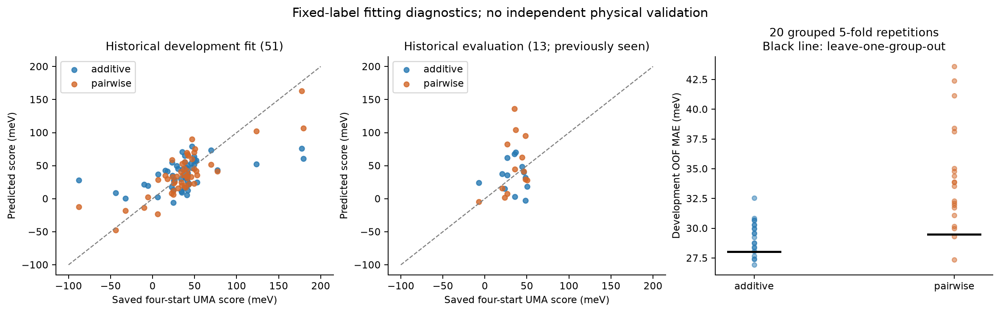
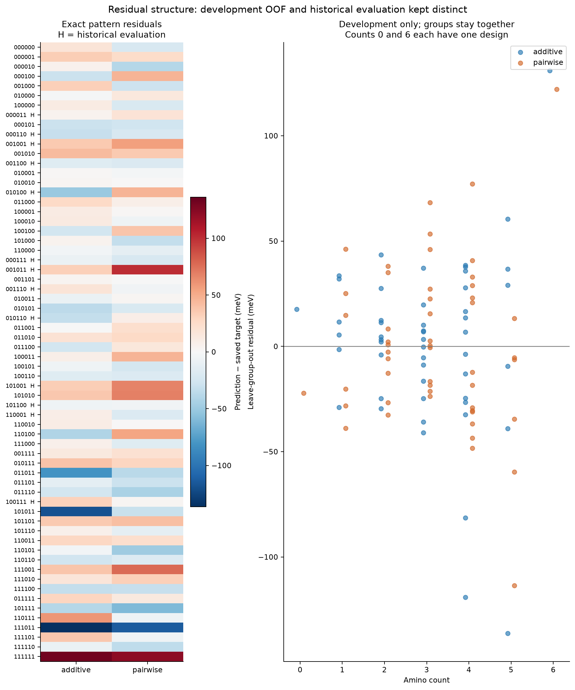
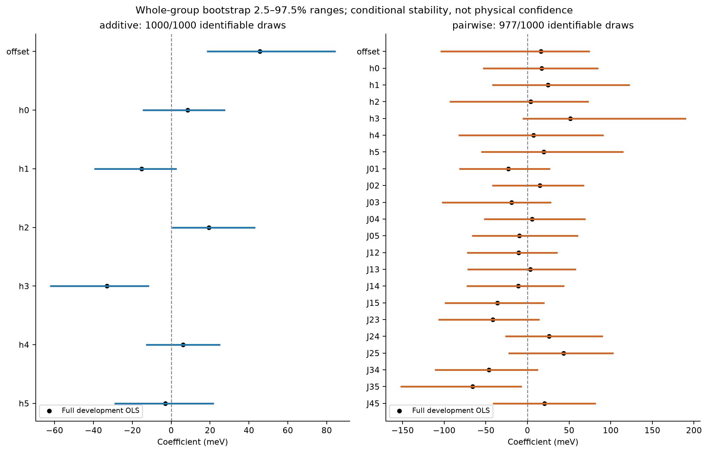
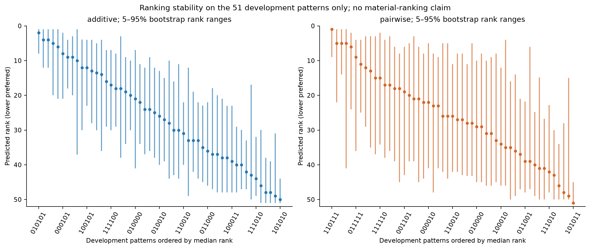
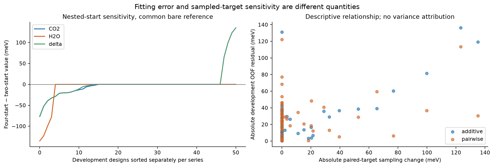

# Offline UiO-66 development analysis v1 — 26 October 2026

**The historical comparison reproduces. Pairwise flexibility lowers fitting error,
but its extra coefficients are poorly stable and its development MAE is generally
worse than additive. This supports retaining additive as a descriptive reference,
not treating either model's preferred pattern as a physically reliable ranking.**

ODAC25 identity/reference investigation is **paused by user instruction**, pending
a source-side response. The request remains **unsent**; no contact is authorized.
See [request status](ODAC25_REQUEST_STATUS.json). Its packet is unchanged.

All new fits below are **exploratory development analyses**. Original fits,
targets, split, sampling protocols, failed pilot and DFT evidence remain unchanged.
No QE/UMA inference, new adsorption calculation or download ran.

## Historical reproduction and exact split

The target is `min_four_starts Eads(CO2) - min_four_starts Eads(H2O)`, in eV;
lower is preferred by the saved score. Both gases share the selected common
sampled empty-framework reference. This is not equilibrium DAC selectivity.

The existing seed-41 split was rebuilt from the pinned initial and relaxed
duplicate-group audits, without labels. It contains **51 development patterns in
42 merged groups**, and **13 historical evaluation patterns in 11 groups**.
All-one and all-zero development pilot groups remain in development. The
[exact original split](../plans/uio66-offline-development-v1/results/exact_split.json)
lists every ID and group. The 13 historical patterns are:

```text
000011 000110 000111 001001 001011 001100 001110
010100 010110 100111 101001 101100 110001
```

These 13 designs were previously inspected: **not a new untouched test set**.
They enter only historical reconstruction and descriptive residual reporting,
never the new CV, bootstrap, coefficient-sensitivity fits or ranking population.

Four raw report hashes, split-source hashes, archived fit-source hashes and cached
audit/report bindings were verified. Saved component energies reconstruct every
target exactly. OLS coefficients, predictions, metrics and the original
200-draw bootstrap (193 identifiable pairwise draws) reproduce to 1e-11 absolute
tolerance. Expensive trajectory/chemistry audits were not rerun.

Historical model equations, with the original slot order retained:

`additive: b + sum_i h_i x_i` (7 parameters)

`pairwise: b + sum_i h_i x_i + sum_{i<j} J_ij x_i x_j` (22 parameters).

| Evidence / metric | Additive (meV) | Pairwise (meV) |
|---|---:|---:|
| Historical development MAE | 24.0373 | 17.1251 |
| Historical development RMSE | 35.4600 | 22.8259 |
| Historical 13-design evaluation MAE | 23.8031 | 30.1754 |
| Historical 13-design evaluation RMSE | 27.5139 | 41.3030 |
| New development leave-group-out MAE | 28.0492 | 29.5076 |
| New development leave-group-out RMSE | 41.0423 | 38.5514 |
| New development group-balanced leave-group-out MAE | 29.4306 | 30.8422 |



## Development resampling: boundaries and results

The [analysis protocol](../plans/uio66-offline-development-v1/protocol.json) was
saved before this exploratory run. It fixes both OLS model classes, seed20261026,
42 leave-one-group-out folds, 20 repeated five-fold partitions of whole groups,
and 1,000 whole-group bootstrap draws. No hyperparameter search or new model class.
Group members and every duplicate bootstrap copy stay together. The frozen
grouping is a duplicate-screening rule, not proof that 42 groups are independent
chemistries: all belong to the same provisional template family.

All **142 CV folds** were identifiable for both models; all 51 development
patterns receive out-of-fold predictions in every repetition. Pairwise MAE is
worse in **19/20** repeated grouped five-fold runs. Median MAE is **29.4083 meV
additive versus 33.6896 meV pairwise**. Across repetitions, additive ranges
26.9326–32.5389 meV and pairwise 27.3700–43.5893 meV. The median *paired* MAE
difference is +4.1047 meV; it differs from the difference of the two medians.
Repetitions reuse data: 19/20 is descriptive, not an independent-trials p-value.

The RMSE result is not uniformly unfavorable to pairwise: leave-group-out RMSE
improves by 2.4908 meV, while MAE worsens by 1.4584 meV. Report both; do not
select a favorable metric after inspection.

## Residuals by composition and substitution pattern

Residual sign is **prediction minus saved four-start target**. Positive values
predict a less favorable score than the saved target. Exact pattern-level
in-sample/historical and development out-of-fold residuals are in
[the CSV](../plans/uio66-offline-development-v1/results/residuals_by_pattern.csv).

| Amino count | Development designs | Additive leave-group-out MAE (meV) | Pairwise (meV) |
|---:|---:|---:|---:|
| 0 | 1 | 17.556 | 22.155 |
| 1 | 6 | 18.857 | 28.883 |
| 2 | 10 | 16.272 | 16.473 |
| 3 | 13 | 16.709 | 24.360 |
| 4 | 14 | 34.144 | 33.809 |
| 5 | 6 | 51.811 | 38.757 |
| 6 | 1 | 130.995 | 122.145 |

Errors depend on arrangement and composition; there is no uniform pairwise
advantage. Pairwise helps the high-count tail but has higher MAE at counts 1–3.
Counts0/6 each contain one pattern: leaving it out is an extrapolation diagnostic,
not a reliable estimate of a composition population. The historical 13 are
concentrated at counts2/3/4 (5/7/1 designs), which differs from the full development
composition mix. These observations describe this split, not a general chemical law.

On the historical set, pattern **001011** contributes 67.9859 meV of the
82.8402 meV total excess pairwise absolute error; **101001** contributes another
34.0029 meV. Other patterns offset part of those increases. In 001011, residuals
are +100.6442 meV pairwise versus +32.6583 meV additive. Conversely, pairwise
reduces absolute error on 100111 by 28.7957 meV. None was removed or downweighted.
These are measured error contributions, not causal chemical explanations.



## Coefficient and predicted-ranking stability

The full pairwise design has rank22 and condition number17.85 (additive5.19).
It is identifiable in the original data; the failure is not simply a singular
original least-squares solve. It uses 22 parameters for 51 rows / 42 groups,
versus seven additive parameters.

Among 1,000 bootstrap draws, additive is identifiable in1,000 and pairwise in977.
All23 rank-deficient pairwise draws remain recorded in `bootstrap_fits.json`;
no pseudoinverse substitute or retry was used. Pairwise summaries are conditional
on the identifiable977, which must be considered when interpreting them.

**14/15 interaction-coefficient 2.5–97.5% ranges cross zero.** Only J35 excludes
zero in this resampling; this is not evidence of a validated chemical interaction
or a multiple-comparison-adjusted significance claim. The median interaction
range width is121.998 meV. Intercepts/linear terms in these two parameterizations
have different conditional meanings; their signs need not agree across models.



Rankings are evaluated **only over the 51 development patterns**, relative to
each model's fixed full-development fit. They are conditional prediction
stability diagnostics, not held-out ranking accuracy or material rankings.

| Bootstrap diagnostic | Additive | Pairwise |
|---|---:|---:|
| Spearman to full fit, median | 0.8995 | 0.7601 |
| Top10 overlap, median | 0.70 | 0.60 |
| Top10 overlap, 5th–95th percentile | 0.50–0.90 | 0.30–0.90 |
| Distinct predicted best patterns across accepted draws | 16 | 39 |
| Original full-development preferred pattern retained | 422/1000 | 494/977 |

Those preferred patterns are010101 for additive and110111 for pairwise. They are
reported to identify instability, not recommended as materials. Bootstrap
percentiles are finite-pool reweighting summaries; they do not cover new motifs,
UMA systematic error, chemistry validity or all possible minima.



## Fitting error versus underlying sampled-target uncertainty

Fitting residuals compare a surrogate with **fixed recorded labels**. Separately,
we compare the nested first-two starts with all four saved starts, using the same
four-start bare reference. This isolates the available guest-start sensitivity;
it does not reproduce a complete two-start bare-reference search.

| Development-only change, four minus two starts | Mean signed (meV) | Mean absolute (meV) | Maximum absolute (meV) |
|---|---:|---:|---:|
| CO2 sampled adsorption energy | −7.0725 | 7.0725 | 76.7758 |
| H2O sampled adsorption energy | −8.5590 | 8.5590 | 135.1513 |
| Paired score | +1.4865 | 15.1232 | 135.1513 |

The small *mean signed* score change hides cancellation. Gas components remain
separate in the saved analysis. Development target-rank Spearman is0.7063 and
top10 overlap0.50. The historical all64 counterparts remain0.7260 and0.40;
different populations explain those different figures.

Exploratory fits to the two-start prefix use only the same51 development IDs.
The largest pairwise coefficient change is50.6196 meV; predicted development-rank
Spearman between two-/four-start fits is0.5352 (additive0.5132). Both models are
sensitive to target construction. No prefix model replaces the historical fit.



Nested starts are not independent repeats. Site-energy spreads are differences
among sampled configurations, not standard errors. Unseen minima can lower either
gas further; these changes are neither upper bounds nor calibrated confidence
intervals. This analysis cannot decompose residual variance uniquely into model
misspecification and sampling error. The archived32-start pilot's failed stability
assessment and tighter-force diagnostics remain separate evidence; they were not
pooled into new targets or resampling here.

## Why pairwise underperformed: measured versus hypothesized

**Measured:** extra pair terms improve in-sample error, but typical grouped-CV
MAE worsens, interaction coefficients vary widely, some resamples lose rank, and
historical evaluation error is concentrated in several arrangements. Both model
predictions change materially when sampled targets change. Pairwise helps some
high-count patterns and leave-group-out RMSE, so the result is not that all pair
terms are useless.

**Supported interpretation:** the unconstrained22-parameter fit has greater
estimation variability than the seven-parameter additive fit for this limited
design set. The extra flexibility is not yielding robust MAE improvement.

**Hypotheses, not established causes:** extra terms may absorb start-dependent
label fluctuations; separately minimizing over adsorption motifs/host conformations
may produce a score poorly approximated by a quadratic; higher-order chemistry
or slot-orientation effects may matter. The available sampled labels do not
identify which mechanism dominates. No physical interaction, reliable optimum
or SNN advantage follows from these fits.

## Reproduction, checks and next decision

From the repository root:

```powershell
python -m scripts.analyze_uio66_development --output local/uio66-development-replay-NEW
python -m pytest tests/test_uio66_development.py tests/test_design_fit.py -q -p no:cacheprovider --basetemp local/uio66-development-tests-NEW
```

Choose new output/temp directories. The script refuses to overwrite an output
directory. It uses local NumPy/SciPy/ASE/Matplotlib and the saved source files;
no CUDA, model checkpoint or electronic-structure executable is required.
Plots are supplied as PNG and SVG. All source/output hashes are recorded in
[the run receipt](../plans/uio66-offline-development-v1/results/receipt.json).

**Seven targeted tests passed** in2.32s: historical fit tests plus new grouped
boundary checks, held-group-label perturbation, rank-failure handling, component
cancellation and metric checks. The recorded full run separately verifies all
142 fold boundaries and bootstrap memberships. All five figures were inspected.
Historical input hashes remain unchanged. Existing unrelated local edits remain
untouched; no commit or push was performed.

**Next decision supported by this evidence:** retain additive as the conservative
descriptive reference and pairwise as an unstable exploratory approximation.
Do not increase model complexity or interpret h/J physically from these labels.
If another offline model comparison is desired, first register a development-only
grouped regularization/symmetry study; it is not automatically launched here.
Physical ranking claims require stable adsorption targets and separate scientific
validation. Higher-cutoff DFT remains deferred for RAM. ODAC25 remains paused,
request unsent, and Phase3 incomplete.
